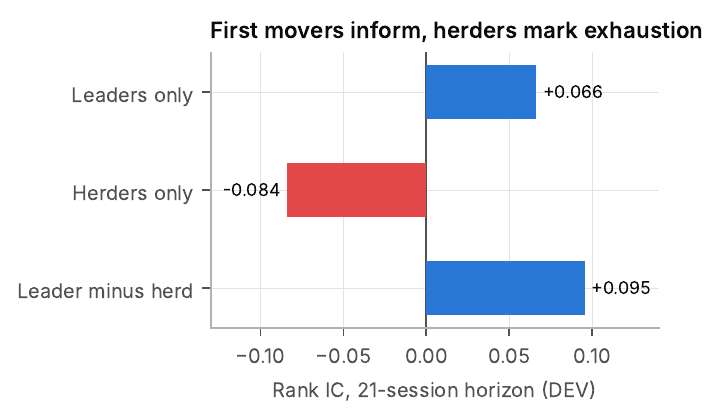
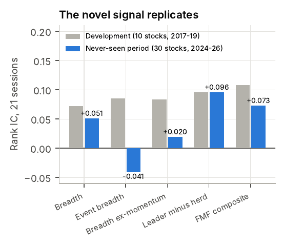
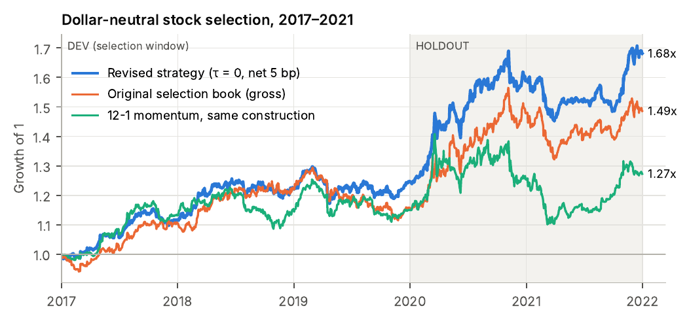
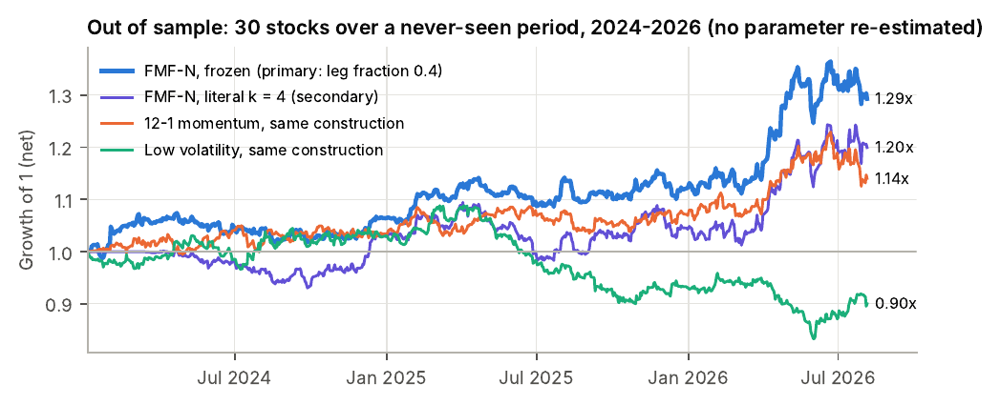
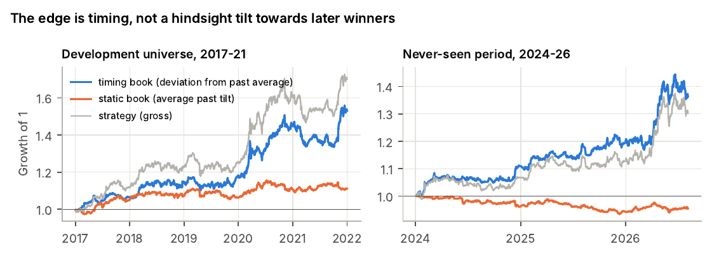
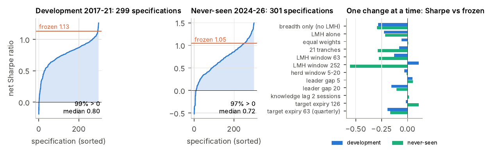
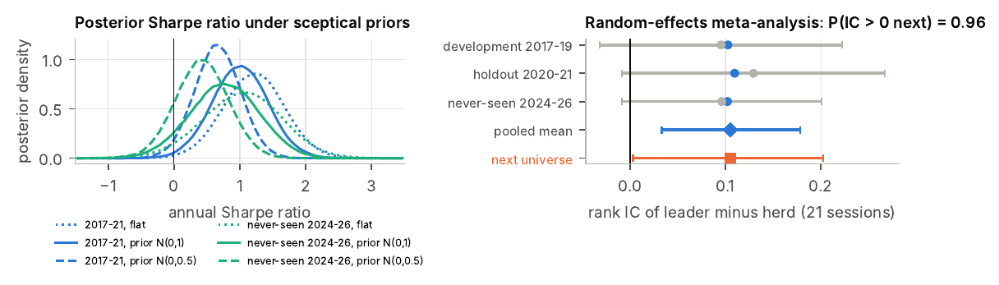
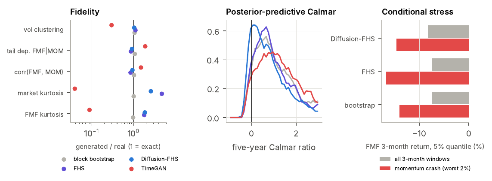
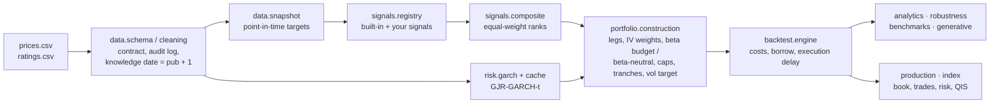

# First-Mover Flow

**Zero-beta stock selection for concentrated equity portfolios, built on who revises their target price first and when tested with a method adapted for small concentrated samples.**

[](https://github.com/bahakh19/first-mover-flow/actions/workflows/ci.yml)


[](https://colab.research.google.com/github/bahakh19/first-mover-flow/blob/main/notebooks/00_quickstart.ipynb)
[](https://mybinder.org/v2/gh/bahakh19/first-mover-flow/HEAD?urlpath=lab/tree/notebooks/00_quickstart.ipynb)
[](https://codespaces.new/bahakh19/first-mover-flow)

`fmflow` is a self-contained research-to-production package. From two plain tables, daily prices and sell-side target prices, it produces a daily dollar-neutral book. Around that core it adds:

- the **validation battery** of the accompanying paper: placebos, leave-one-out, a multiverse of specifications, data-snooping-robust tests, Bayesian small-sample inference and power analysis
- **generative stress tests**: bootstrap, FHS, a hybrid GARCH–diffusion model and TimeGAN
- **production tools** for a portfolio manager: today's book, a trade list, a risk report and a signal monitor
- a **QIS index** calculator with a generated rulebook
- a **pre-registration** utility and a calibrated **synthetic data** generator.

Everything runs on your own universe.

> **Paper:** Khaled Baha, *Who Revises First? Analyst Revision Flow and Zero-Beta Stock Selection in Concentrated Equity Portfolios*, [`docs/paper.pdf`](docs/paper.pdf)
> **Two-page summary:** [`docs/Tearsheet.pdf`](docs/Tearsheet.pdf) · **Objections and answers:** [`OBJECTIONS.md`](OBJECTIONS.md) · **All results:** [`RESULTS.md`](RESULTS.md)


## Get started

Pick the route that suits you. None of them needs Python to be installed beforehand.

| Route | How | What you get |
|---|---|---|
| **In the browser, nothing to install** | Click **Open in Colab** on any notebook below, or the Binder / Codespaces badge above | The notebook's first cell fetches the repository and installs the package (about a minute) |
| **One command on your computer** | macOS / Linux: `./setup.sh` · Windows: double-click `setup.cmd` (or `.\setup.ps1` in PowerShell) | A `.venv` with Python 3.12 and every dependency, a Jupyter kernel "Python (fmflow)", and an environment check |
| **Manual** | `pip install -e ".[notebooks,dev]"` in a fresh virtual environment, or conda | See [INSTALL.md](INSTALL.md) for every option and known issue |
| **Docker** | `docker build -t fmflow .` then `docker run --rm -p 127.0.0.1:8888:8888 fmflow` | JupyterLab on http://localhost:8888 |

```bash
git clone https://github.com/bahakh19/first-mover-flow.git
cd first-mover-flow
./setup.sh                      # Windows: setup.cmd   (installs uv and Python if needed; a few minutes the first time)
```

Then, from the repository folder (prefix each command with `uv run`, or activate `.venv` first):

```bash
python tasks.py demo            # the pre-registered out-of-sample test on the shipped data, about a minute
python tasks.py lab             # JupyterLab on the notebooks
python tasks.py test            # the fast test suite (in parallel)
python tasks.py                 # every task: doctor, test-all, lint, notebooks, docs, synth, development, audit, power, clean
```

`tasks.py` works identically on macOS, Windows and Linux (`make <task>` is a shortcut on macOS and Linux). If anything fails, run `python tasks.py doctor` (or `fmflow doctor`): it checks every dependency the way the package uses it and prints the fix.

---

## The problem

Tech, thematic and high-conviction funds, and QIS baskets on narrow universes, all hold **10–30 names**. Three problems follow from that:

1. **Low breadth:** A ten-stock universe gives few independent bets, so genuine selection skill is statistically hard to detect. Detecting an IC of 0.10 with ten stocks over three years is a coin flip.
2. **Factor dominance:** Most "alpha" signals turn out to be the market or momentum under another name.
3. **Beta camouflage:** An overlay that adds net exposure in a rising market inflates the Calmar ratio and looks like skill. Our own first-generation strategy, *Regime-Timed Breadth* (RTB), reached a Calmar of 1.77, but its timing leg underperformed a **static** beta of the same size, and its selection book alone had a Sharpe of only 0.63.

## The idea: leader minus herd

Analysts do not revise at the same time.

- **Leaders (first movers)** revise on an information-event day (five or more same-day ratings) or after at least 10 sessions of silence on the stock. They have done the work, and the market takes weeks to absorb it.
- **Herders** revise 3–15 sessions after an event cluster, in the cluster's direction. By then the move is in the price.

`leader_minus_herd` (LMH) is the net direction of leaders minus herders over 126 sessions. It is combined with three revision-breadth signals in an **equal-weight rank composite**, and traded long the top 40% and short the bottom 40% of names, inverse-volatility weighted within each leg, held as **42 overlapping daily tranches**, at zero net exposure.

<p align="center"> </p>

## Results

All figures are net of 5 bp per unit traded. Every choice was made on 2017–2019 only.

| | Sharpe | Calmar | Max DD | Beta | Alpha (t) |
|---|---:|---:|---:|---:|---:|
| **FMF-N**, 10 US large caps, 2017–21 | **1.13** | **0.78** | −14.1% | −0.02 | 7.4% after 4 factors (2.98) |
| **FMF-B20** (FMF-N + constant 0.2 beta budget), 2017–21 | 1.62 | **1.66** | −10.8% | 0.17 | 11.9% CAPM (2.40) |
| Gen-1 RTB (regime-timed), 2017–21, gross | 1.48 | 1.39 | −13.6% | 0.11 | |
| Equal-weight market, 2017–21 | 1.28 | 0.87 | −38.1% | 1.00 | |
| **FMF-N, 30 stocks over the never-seen period 2024–26 (pre-registered)** | **1.05** | **1.32** | −8.0% | −0.02 | 11.4% CAPM (2.04) |
| FMF-N, the 20 of those stocks never used in development (post hoc) | 0.80 | 0.98 | −9.2% | | |

The out-of-sample period never overlaps the development period, but ten of its thirty names are the development names. On the twenty new names alone, the frozen specification earns a Sharpe ratio of 0.80 and leader minus herd keeps its information coefficient (0.105). Details: [DATA_SOURCES.md](DATA_SOURCES.md) §3.

<p align="center"></p>
<p align="center"></p>

## Attacked from nine angles

| Objection | Test | Result |
|---|---|---|
| "Hindsight universe: it is just long the winners." | Lo (2008) decomposition; causal static vs timing books | **Timing** Sharpe 1.04 (*t* 2.41), never-seen 1.33 (*t* 2.21). Static tilt insignificant, and **negative** out of sample |
| "Fills at the signal close and free shorts are fantasy." | 0–2 day delay × 0–200 bp borrow × 0–30 bp costs | Sharpe 1.06 with a 1-day delay, 100 bp borrow and 10 bp costs, breakeven cost **234 bp** per unit traded |
| "Smoothed P&L inflates the Sharpe." | Lo (2002) adjusted Sharpe | 1.06 (never-seen 1.06), lag-1 autocorrelation 0.04 |
| "Zero beta hides crash beta." | Up/down-market betas | Down beta −0.07, positive mean return in the worst market weeks |
| "You chose the parameters that work." | Multiverse of ~300 specifications (incl. quarterly expiry, 2-day knowledge lag), SPA, PBO, ensemble | **99%** of specifications positive (97% never-seen); selection-free ensemble Sharpe 0.92 (0.86) |
| "The new signal adds nothing to breadth." | Same book without LMH, block bootstrap | +0.29 Sharpe (*p* 0.028), never-seen +0.30, pooled P(gain > 0) = 0.94 |
| "Beating the toolkit is cherry-picking." | Romano–Wolf step-down vs 16 books, reverse SPA | No comparable beats FMF-N (SPA *p* 0.86 / 0.86) |
| "Ten stocks prove nothing." | Bayesian Sharpe, random-effects meta-analysis of 3 independent samples, empirical-Bayes shrinkage, power | P(signal works in the **next** universe) = **0.96**, pooled IC 0.105, Stouffer *p* = 0.002 |
| "One history has one drawdown." | Diffusion-FHS, FHS, bootstrap and TimeGAN with posterior-predictive drift | Five-year median Calmar 0.70, 5% max drawdown −34%, P(5-year loss) 14% (Diffusion-FHS), TimeGAN fails fidelity and is excluded. Binding stress: momentum crashes, not market crashes |

Full write-up: [OBJECTIONS.md](OBJECTIONS.md) · Paper, Sections 10–11.

<p align="center"></p>
<p align="center"></p>
<p align="center"></p>
<p align="center"></p>

---

## Use it

The package works on any universe given as two long tables, `date, stock, price` and `date, estimate_value, stock, analyst` (CSV in any common dialect, Excel or Parquet, see [DATA.md](DATA.md)).

| I want to… | Command |
|---|---|
| Reproduce the pre-registered out-of-sample test | `python tasks.py demo` |
| Check my environment | `fmflow doctor` |
| Check my data before running anything | `fmflow validate --prices P.csv --ratings R.csv` |
| Run the strategy on my data | `fmflow run --prices P.csv --ratings R.csv --leg-fraction 0.4 --out results/` |
| Get today's book, trades and risk report | `fmflow book --prices P.csv --ratings R.csv --nav 25e6 --prices-ccy closes.csv --holdings holdings.csv` |
| Run the full validation battery | `fmflow evaluate --prices P.csv --ratings R.csv --placebo --loo` |
| Get Bayesian and snooping-robust inference | `fmflow infer --prices P.csv --ratings R.csv` |
| Run the multiverse of specifications | `fmflow multiverse --prices P.csv --ratings R.csv --n-random 200 --jobs 4` |
| Build a QIS index and its rulebook | `fmflow index --prices P.csv --ratings R.csv --fee-bps 50 --vol-target 0.10` |
| Run generative stress tests | `fmflow stress --prices P.csv --ratings R.csv --generator diffusion --paths 1000` |
| Freeze a specification before evaluating it | `fmflow register --config my.json --title "..." --out configs/my_prereg.json` |
| Generate realistic synthetic data | `fmflow synth --preset open --seed 7 --out data/synthetic/` |

`fmflow --help` lists the commands and `fmflow <command> --help` their options. `python -m fmflow` works the same where the `fmflow` script is not on the PATH. Every analysis command prints its tables and, with `--out DIR`, also writes them as CSV files. Errors in the input are reported in one line (add `--debug` for the traceback).

**Python API**

```python
from fmflow import StrategyConfig, load_prices, load_ratings, run_strategy
from fmflow.signals.registry import register_signal
from fmflow.robustness import signal_ic_table, truncation_check

prices  = load_prices("my_prices.csv")                     # date, stock, price
ratings = load_ratings("my_targets.csv", prices)           # date, estimate_value, stock, analyst

@register_signal("coverage_momentum")                      # add your own causal signal
def _(ctx):
    n = ctx.snap.n_active.reindex(index=ctx.px.index, columns=ctx.px.columns)
    return n.diff(63)

cfg = StrategyConfig.fmf_n_scalable().with_(vol_target=0.10, borrow_bps=50, execution_lag=1)
out = run_strategy(prices, ratings, cfg, cache_dir=".fmflow_cache")   # file paths work too
out                                                        # one-line overview: universe, sample, net Sharpe
out.summary()                                              # CAGR, vol, Sharpe, drawdown, Calmar, beta, alpha, PSR, turnover
out.weights, out.net_returns, out.signals, out.audit       # book, P&L, signal panels, cleaning log
signal_ic_table(out, h=21)
truncation_check(prices, ratings, cfg.with_(signals=cfg.signals + ("coverage_momentum",)), ["2024-06-28"])
```

## Notebooks

Every notebook runs from the shipped open data, except the full research notebook, which needs the proprietary development data. Locally: `python tasks.py lab`. Re-execute them all: `python tasks.py notebooks`.

| Notebook | For | What it shows | Run online |
|---|---|---|:---:|
| [`00_quickstart`](notebooks/00_quickstart.ipynb) | everyone | Synthetic data, a null-world control, the open out-of-sample dataset, your own data in three lines | [](https://colab.research.google.com/github/bahakh19/first-mover-flow/blob/main/notebooks/00_quickstart.ipynb) |
| [`Research_notebook_FMF`](notebooks/Research_notebook_FMF.ipynb) | reviewers | The full study (Sections 1–17): RTB, FMF, comparables, leave-one-out, out of sample, the adversarial audit. Needs `data/private/` | needs private data |
| [`02_data_ingestion_and_point_in_time`](notebooks/02_data_ingestion_and_point_in_time.ipynb) | data engineers, researchers | Contract errors, vendor mapping, cleaning audit, point-in-time snapshot, causality audit | [](https://colab.research.google.com/github/bahakh19/first-mover-flow/blob/main/notebooks/02_data_ingestion_and_point_in_time.ipynb) |
| [`03_signal_research_lab`](notebooks/03_signal_research_lab.ipynb) | researchers | LMH anatomy, IC decay and stability, Fama–MacBeth, adding and auditing a custom signal | [](https://colab.research.google.com/github/bahakh19/first-mover-flow/blob/main/notebooks/03_signal_research_lab.ipynb) |
| [`04_portfolio_construction_and_risk`](notebooks/04_portfolio_construction_and_risk.ipynb) | PMs, risk | Legs, allocators, tranches, beta neutrality vs budget, caps, vol targeting, costs/borrow/delay, breakeven | [](https://colab.research.google.com/github/bahakh19/first-mover-flow/blob/main/notebooks/04_portfolio_construction_and_risk.ipynb) |
| [`05_robustness_and_small_sample_inference`](notebooks/05_robustness_and_small_sample_inference.ipynb) | researchers, allocators | Identity vs timing, placebos, leave-one-out, multiverse + SPA + PBO, Romano–Wolf, Bayesian, meta-analysis, power | [](https://colab.research.google.com/github/bahakh19/first-mover-flow/blob/main/notebooks/05_robustness_and_small_sample_inference.ipynb) |
| [`06_generative_stress_testing`](notebooks/06_generative_stress_testing.ipynb) | risk, allocators | Bootstrap vs FHS vs Diffusion-FHS vs TimeGAN, fidelity, Calmar distribution, conditional crashes | [](https://colab.research.google.com/github/bahakh19/first-mover-flow/blob/main/notebooks/06_generative_stress_testing.ipynb) |
| [`07_qis_index_construction`](notebooks/07_qis_index_construction.ipynb) | QIS structurers | ER/TR index, fees, vol target, factsheet, blends with factor indices, generated rulebook | [](https://colab.research.google.com/github/bahakh19/first-mover-flow/blob/main/notebooks/07_qis_index_construction.ipynb) |
| [`08_pm_daily_workflow`](notebooks/08_pm_daily_workflow.ipynb) | PMs, traders | Today's book, trade list in shares, risk report, signal health, what changed overnight | [](https://colab.research.google.com/github/bahakh19/first-mover-flow/blob/main/notebooks/08_pm_daily_workflow.ipynb) |
| [`09_bring_your_own_universe`](notebooks/09_bring_your_own_universe.ipynb) | everyone | A complete, honest research cycle: power → development → pre-registration → confirmation | [](https://colab.research.google.com/github/bahakh19/first-mover-flow/blob/main/notebooks/09_bring_your_own_universe.ipynb) |
| [`Data_Gathering`](notebooks/Data_Gathering.ipynb) | data engineers | Rebuild the open dataset from Kaggle and Yahoo Finance, normalise it, compare with the shipped files (needs your Kaggle token) | [](https://colab.research.google.com/github/bahakh19/first-mover-flow/blob/main/notebooks/Data_Gathering.ipynb) |

## Architecture



```
src/fmflow/
├── config.py            every tunable number; presets fmf_n, fmf_n_scalable, fmf_b20, fmf_beta_neutral, fmf_vt10, conservative_costs
├── data/                schema.py (contract) · io.py (CSV dialects, Excel, Parquet) · cleaning.py (audit log) · snapshot.py
│                        (point in time) · normalize.py (anonymise and rescale a raw universe)
├── signals/             registry.py (register your own) · breadth.py · leader_herd.py · composite.py · price.py · analyst.py
├── risk/garch.py        walk-forward GJR-GARCH(1,1)-t;  cache.py: content-addressed on-disk cache
├── portfolio/           construction.py: legs, IV weights, beta budget / beta-neutral, caps, Ledoit–Wolf vol targeting, tranches
├── backtest/engine.py   costs, short-borrow fees, execution delay, breakeven cost, cost sensitivity grids
├── analytics/           metrics · inference (IC tests, PSR/DSR, PBO, bootstrap, Fama–MacBeth) · snooping (White, Hansen SPA,
│                        Romano–Wolf, Sharpe-difference) · bayes (Bayesian Sharpe, random-effects meta-analysis, shrinkage,
│                        Bayes factors) · attribution (Lo 2008, static vs timing) · power · placebo
├── robustness.py        IC tables, placebos, leave-one-out, multiverse, truncation_check
├── generative/          windows · baselines (bootstrap, FHS) · ddpm · diffusion_fhs · timegan · fidelity · stress
├── production.py        latest_book, trade_list, risk_report, signal_monitor
├── index.py             QIS index levels (ER/TR), fees, vol target, factsheet, rulebook
├── benchmarks.py        13 institutional signals + 3 allocations, same construction
├── pipeline.py          run_strategy, construct_book, StrategyOutput (.summary(), .weights, .net_returns, .audit)
├── prereg.py · synthetic.py · report.py · plotting.py · cli.py (fmflow command, also python -m fmflow)
```

```
repository
├── setup.sh · setup.ps1 · setup.cmd   one-command setup (macOS / Linux / Windows)
├── tasks.py · Makefile                 cross-platform task runner (doctor, demo, test, lab, notebooks, ...)
├── src/fmflow/                         the package (above)
├── notebooks/                          00, 02–09 use cases · Research_notebook_FMF (full study) · Data_Gathering
├── scripts/                            reproduce_*.py (paper sections) · overlap_analysis · fuzz_causality · run_notebooks · make_api_docs
├── tests/                              unit, causality, parity, CLI, data dialects (fixtures: reference weights, GARCH forecasts)
├── data/open/ · data/private/          shipped open data · your copy of the proprietary data (git-ignored)
├── configs/                            frozen specifications and the pre-registration file
├── docs/                               paper.pdf · Tearsheet.pdf · API.md · figures/
├── .devcontainer/ · binder/ · Dockerfile   Codespaces, Binder and Docker environments
└── pyproject.toml · uv.lock            dependencies (extras: plot, notebooks, gen, io, research, data, dev, all) and the lock file
```

**Design rules**

* **Causality is tested, not asserted:** Every signal, the composite and the weights are recomputed on truncated data and must match the full run (`truncation_check`). A deliberately leaky control must fail the same test.
* **One source of truth:** Every number lives in `config.py` and serialises to JSON, so a specification can be fingerprinted before evaluation.
* **Same construction for every comparison:** Comparables, placebos, leave-one-out runs and the multiverse all build their books with `pipeline.construct_book`, the function the strategy itself uses, with the same costs, borrow fee and execution delay.
* **Parity with the research notebook:** With the shipped GARCH forecasts, the package reproduces the notebook's weights exactly on both datasets (`tests/test_parity.py`). Re-estimating GARCH from scratch with the default optimiser is exact on one machine but can differ across CPUs, because the short-sample likelihood has near-equal local maxima; `DataConfig(garch_method="grid")` is a deterministic estimator that gives bit-identical forecasts on every machine (out-of-sample Sharpe 1.09 with it, against 1.05).
* **Extensible:** You can register signals, pass `extra` user data and a sector map, and plug in your own GARCH forecasts or allocator.

## Reproducing the paper

| Paper | Research notebook section | Script |
|---|---|---|
| §5 RTB and its decomposition | Sections 1–13 | (development data) |
| §6–7 FMF signals, construction, performance, placebos | Section 14 | `scripts/reproduce_development.py --placebo` |
| §8 Institutional comparables | Section 15.1 | `fmflow compare` |
| §7.4 Leave-one-out | Section 15.2 | `scripts/reproduce_development.py --loo` |
| §9 Never-seen period (pre-registered) | Section 16 | `scripts/reproduce_open_universe.py [--placebo]` |
| Overlap check: 20 new names vs 10 development names | – | `scripts/overlap_analysis.py` |
| §10 Nine objections | Sections 17.0–17.5 | `scripts/reproduce_audit.py` (`python tasks.py audit`) |
| §11 Generative stress testing | Section 17.6 | `scripts/reproduce_audit.py --blocks 16` |
| Synthetic validation | – | `scripts/synthetic_power_study.py` |

## Testing

```bash
python tasks.py test        # fast: unit, causality, contract, data dialects, open-universe parity, CLI (in parallel)
python tasks.py test-all    # + slow: GARCH re-estimation, development parity (if data/private exists), synthetic power, DDPM, Diffusion-FHS
python tasks.py lint        # ruff
python tasks.py notebooks   # re-execute the use-case notebooks (stops at the first failure)
python tasks.py docs        # regenerate docs/API.md from the docstrings
python scripts/fuzz_causality.py --seeds 10   # messy random universes: truncation test of every signal + book invariants
```

Continuous integration runs the fast tests on Linux, Windows and macOS with Python 3.10 to 3.14, the tests and the pre-registered demo with the oldest dependency versions the package allows, the one-command setup on all three systems, the slow tests and every notebook.

## Limits

* **Small samples:** Single windows have little power. On any one of them, a family-wise test over all specifications is not significant. The evidence is the replication across three independent samples, combined formally.
* **Momentum crashes are the binding stress:** FMF-N is correlated with momentum (about 0.6–0.7). Size and hedge accordingly (paper §11).
* **Universes:** Both are US large caps, in mostly rising markets. The out-of-sample universe is the ten development names plus twenty of today's large caps, a list chosen with knowledge of which companies grew large. The causal timing decomposition and the twenty-new-names check (DATA_SOURCES.md §3) guard against the most likely bias, but a universe chosen by an independent rule would be stronger evidence.
* **Factors and capacity:** Size, value and sector exposures need data not used here. The `sectors=` option neutralises sectors if you have a map. Capacity is assessed through the breakeven cost, not through volume data.

## Data

* **Development data (proprietary, not distributed):** Ten US large caps, 2016–2021, with 5,987 analyst-level target prices. Put the files in `data/private/` to reproduce Sections 5–8 and 10–11.
* **Open data (shipped):** Thirty US large caps, 2023–2026: target prices from the Kaggle dataset [`yijian2427/us-market-analyst-insights-with-full-stock-symbols`](https://www.kaggle.com/datasets/yijian2427/us-market-analyst-insights-with-full-stock-symbols) (MIT) and Yahoo Finance closes, normalised and anonymised in `data/open/`. [`notebooks/Data_Gathering.ipynb`](notebooks/Data_Gathering.ipynb) rebuilds them from scratch and checks the result against the shipped files.

[DATA_SOURCES.md](DATA_SOURCES.md) describes both datasets in detail (provenance, stocks, coverage, cleaning, overlap, licences). [DATA.md](DATA.md) gives the input contract, cleaning rules, vendor mappings and the synthetic calibration.

## Citation

```bibtex
@misc{baha2026whorevisesfirst,
  title  = {Who Revises First? Analyst Revision Flow and Zero-Beta Stock Selection in Concentrated Equity Portfolios},
  author = {Baha, Khaled},
  year   = {2026},
  note   = {Code: https://github.com/bahakh19/first-mover-flow}
}
```

MIT licence. Research code, not investment advice. Past performance, in or out of sample, does not guarantee future results.
