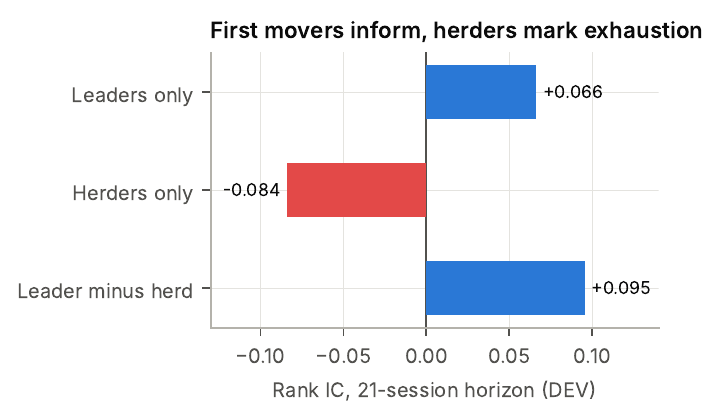
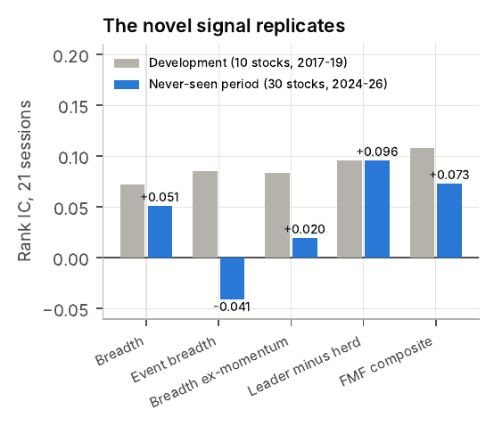
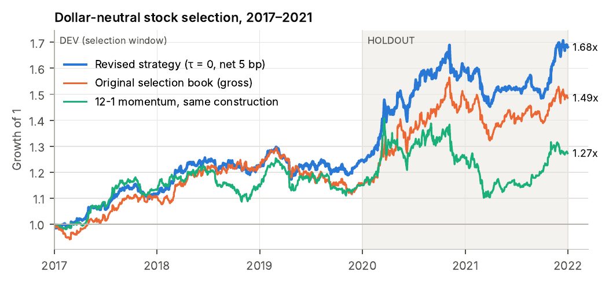
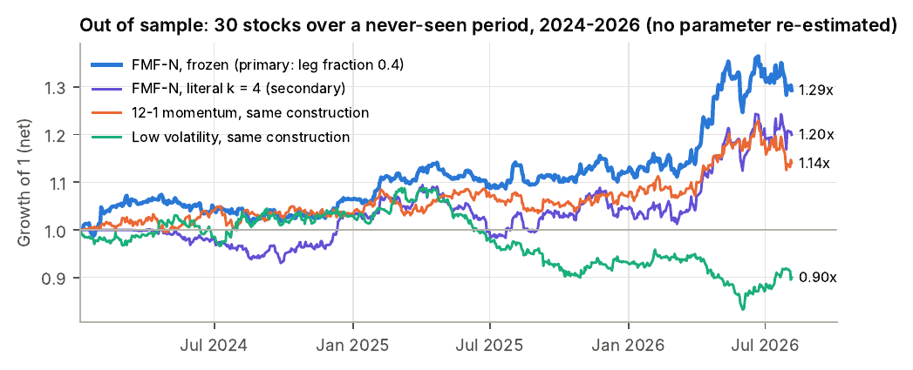
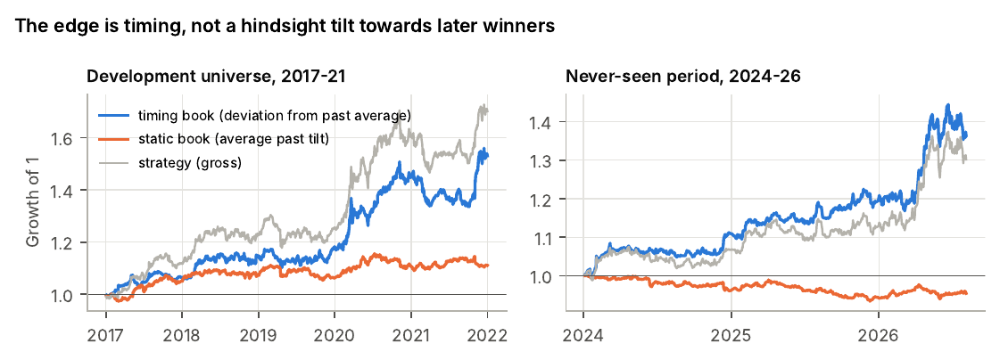
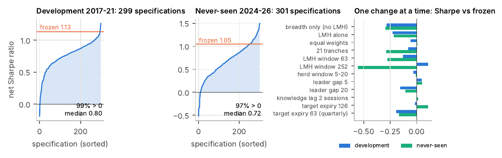
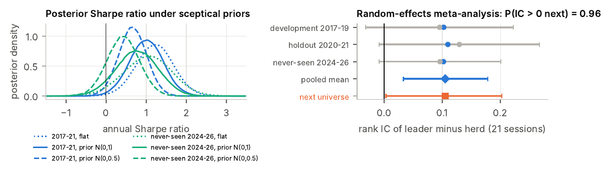
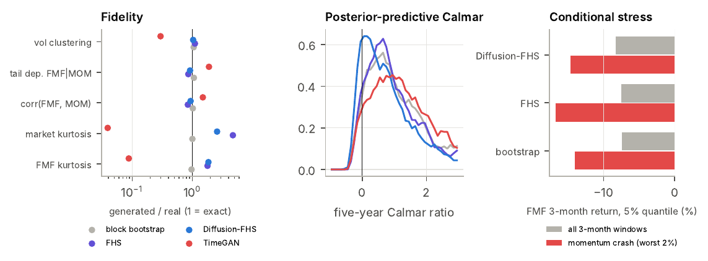
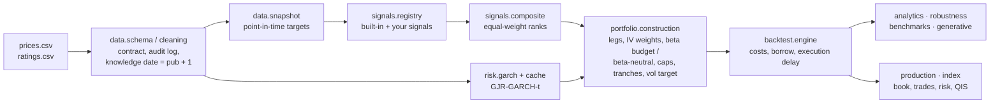

# First-Mover Flow

**Zero-beta stock selection for concentrated equity portfolios. The signal is built on which analyst revises a target price first, and the testing is adapted to small, concentrated samples.**

[](https://github.com/bahakh19/first-mover-flow/actions/workflows/ci.yml)


[](https://colab.research.google.com/github/bahakh19/first-mover-flow/blob/main/notebooks/00_quickstart.ipynb)
[](https://mybinder.org/v2/gh/bahakh19/first-mover-flow/HEAD?urlpath=lab/tree/notebooks/00_quickstart.ipynb)
[](https://codespaces.new/bahakh19/first-mover-flow)

`fmflow` takes a strategy from research through to production in one package. You give it two plain tables (daily prices and sell-side target prices) and it builds a dollar-neutral book every day. Around that core sit several other pieces:

- the paper's **validation battery** (placebos, leave-one-out, a multiverse of specifications, tests that are robust to data snooping, Bayesian inference for small samples, and power analysis)
- **generative stress tests** using a bootstrap, FHS, a hybrid GARCH–diffusion model and TimeGAN
- **production tools** for a portfolio manager, namely today's book, a trade list, a risk report and a signal monitor
- a **QIS index** calculator that also writes the rulebook
- a **pre-registration** utility, plus a calibrated **synthetic data** generator.

All of it runs on whatever universe you bring.

> **Paper:** Khaled Baha, *Who Revises First? Analyst Revision Flow and Zero-Beta Stock Selection in Concentrated Equity Portfolios*, [`docs/paper.pdf`](docs/paper.pdf)
> **Two-page summary:** [`docs/Tearsheet.pdf`](docs/Tearsheet.pdf) · **Objections and answers:** [`OBJECTIONS.md`](OBJECTIONS.md) · **All results:** [`RESULTS.md`](RESULTS.md)


## Get started

There are four ways in, and none of them asks you to install Python first.

| Route | How | What you get |
|---|---|---|
| **In the browser, nothing to install** | Click **Open in Colab** on any notebook below, or the Binder / Codespaces badge above | The notebook's first cell fetches the repository and installs the package (about a minute) |
| **One command on your computer** | macOS / Linux: `./setup.sh` · Windows: double-click `setup.cmd` (or `.\setup.ps1` in PowerShell) | A `.venv` with Python 3.12 and every dependency, a Jupyter kernel "Python (fmflow)", and an environment check |
| **Manual** | `pip install -e ".[notebooks,dev]"` in a fresh virtual environment, or conda | See [INSTALL.md](INSTALL.md) for every option and known issue |
| **Docker** | `docker build -t fmflow .` then `docker run --rm -p 127.0.0.1:8888:8888 fmflow` | JupyterLab on http://localhost:8888 |

```bash
git clone https://github.com/bahakh19/first-mover-flow.git
cd first-mover-flow
./setup.sh                      # Windows: setup.cmd   (installs uv and Python if needed, a few minutes the first time)
```

After that, run these from the repository folder (either put `uv run` in front of each command or activate `.venv` once):

```bash
python tasks.py demo            # the pre-registered out-of-sample test on the shipped data, about a minute
python tasks.py lab             # JupyterLab on the notebooks
python tasks.py test            # the fast test suite (in parallel)
python tasks.py                 # every task: doctor, test-all, lint, notebooks, docs, synth, development, audit, power, clean
```

`tasks.py` behaves the same on macOS, Windows and Linux (on the last two, `make <task>` is a shortcut for it). Should something fail, `python tasks.py doctor` (or `fmflow doctor`) exercises each dependency the way the package actually uses it and tells you how to fix whatever is broken.

---

## The problem

Tech funds, thematic and high-conviction funds, and QIS baskets built on narrow universes all hold **10–30 names**. Working with so few names creates three problems.

1. **Low breadth.** Ten stocks give you few independent bets. Real selection skill is then hard to detect statistically: with ten stocks and three years of data, detecting an IC of 0.10 is a coin flip.
2. **Factor dominance.** Most so-called alpha signals, once you look closely, are the market or momentum in disguise.
3. **Beta camouflage.** Add net exposure in a rising market and the Calmar ratio goes up, which is easy to mistake for skill. It happened to us. *Regime-Timed Breadth* (RTB), our first-generation strategy, reached a Calmar of 1.77. But its timing leg did worse than a **static** beta of the same size, and the selection book by itself had a Sharpe of only 0.63.

## The idea: leader minus herd

Analysts don't all revise at once, and the order matters.

- **Leaders (first movers)** revise either on an information-event day (five or more ratings on the stock that day) or after the stock has gone at least 10 sessions without a revision. These analysts have done the work, and it takes the market weeks to absorb what they found.
- **Herders** follow 3–15 sessions after an event cluster, revising the same way the cluster did. By the time they move, the price already has.

`leader_minus_herd` (LMH) measures, over 126 sessions, the net direction of the leaders minus that of the herders. We combine it with three revision-breadth signals in an **equal-weight rank composite**. The book goes long the top 40% of names and short the bottom 40%, weights each leg by inverse volatility, and is held as **42 overlapping daily tranches** with zero net exposure.

<p align="center"> </p>

## Results

Figures are net of 5 bp per unit traded. Every choice behind them was made on 2017–2019 data only.

| | Sharpe | Calmar | Max DD | Beta | Alpha (t) |
|---|---:|---:|---:|---:|---:|
| **FMF-N**, 10 US large caps, 2017–21 | **1.13** | **0.78** | −14.1% | −0.02 | 7.4% after 4 factors (2.98) |
| **FMF-B20** (FMF-N + constant 0.2 beta budget), 2017–21 | 1.62 | **1.66** | −10.8% | 0.17 | 11.9% CAPM (2.40) |
| Gen-1 RTB (regime-timed), 2017–21, gross | 1.48 | 1.39 | −13.6% | 0.11 | |
| Equal-weight market, 2017–21 | 1.28 | 0.87 | −38.1% | 1.00 | |
| **FMF-N, 30 stocks over the never-seen period 2024–26 (pre-registered)** | **1.05** | **1.32** | −8.0% | −0.02 | 11.4% CAPM (2.04) |
| FMF-N, the 20 of those stocks never used in development (post hoc) | 0.80 | 0.98 | −9.2% | | |

The out-of-sample period never overlaps the development period. But ten of its thirty names were also development names. Restricted to the twenty new names, the frozen specification still earns a Sharpe ratio of 0.80, and leader minus herd keeps its information coefficient (0.105). [DATA_SOURCES.md](DATA_SOURCES.md) §3 has the details.

<p align="center"></p>
<p align="center"></p>

## Attacked from nine angles

| Objection | Test | Result |
|---|---|---|
| "Hindsight universe: it is just long the winners." | Lo (2008) decomposition, causal static vs timing books | **Timing** Sharpe 1.04 (*t* 2.41), never-seen 1.33 (*t* 2.21). Static tilt insignificant, and **negative** out of sample |
| "Fills at the signal close and free shorts are fantasy." | 0–2 day delay × 0–200 bp borrow × 0–30 bp costs | Sharpe 1.06 with a 1-day delay, 100 bp borrow and 10 bp costs, breakeven cost **234 bp** per unit traded |
| "Smoothed P&L inflates the Sharpe." | Lo (2002) adjusted Sharpe | 1.06 (never-seen 1.06), lag-1 autocorrelation 0.04 |
| "Zero beta hides crash beta." | Up/down-market betas | Down beta −0.07, positive mean return in the worst market weeks |
| "You chose the parameters that work." | Multiverse of ~300 specifications (incl. quarterly expiry, 2-day knowledge lag), SPA, PBO, ensemble | **99%** of specifications positive (97% never-seen), selection-free ensemble Sharpe 0.92 (0.86) |
| "The new signal adds nothing to breadth." | Same book without LMH, block bootstrap | +0.28 Sharpe (*p* 0.028), never-seen +0.30, pooled P(gain > 0) = 0.94 |
| "Beating the toolkit is cherry-picking." | Romano–Wolf step-down vs 16 books, reverse SPA | No comparable beats FMF-N (SPA *p* 0.86 / 0.86) |
| "Ten stocks prove nothing." | Bayesian Sharpe, random-effects meta-analysis of 3 independent samples, empirical-Bayes shrinkage, power | P(signal works in the **next** universe) = **0.96**, pooled IC 0.105, Stouffer *p* = 0.002 |
| "One history has one drawdown." | Diffusion-FHS, FHS, bootstrap and TimeGAN with posterior-predictive drift | Five-year median Calmar 0.70, 5% max drawdown −34%, P(5-year loss) 14% (Diffusion-FHS), TimeGAN fails fidelity and is excluded. Binding stress: momentum crashes, not market crashes |

The full write-up is in [OBJECTIONS.md](OBJECTIONS.md) and in Sections 10–11 of the paper.

<p align="center"></p>
<p align="center"></p>
<p align="center"></p>
<p align="center"></p>

---

## Use it

Any universe will do, as long as it comes as two long tables, `date, stock, price` and `date, estimate_value, stock, analyst`. CSV in any common dialect, Excel and Parquet are all accepted ([DATA.md](DATA.md)).

| I want to… | Command |
|---|---|
| Reproduce the pre-registered out-of-sample test | `python tasks.py demo` |
| Check my environment | `fmflow doctor` |
| Check my data before running anything | `fmflow validate --prices P.csv --ratings R.csv` |
| Run the strategy on my data | `fmflow run --prices P.csv --ratings R.csv --leg-fraction 0.4 --out results/` |
| Get today's book, trades and risk report | `fmflow book --prices P.csv --ratings R.csv --nav 25e6 --prices-ccy closes.csv --holdings holdings.csv` |
| Run the full validation battery | `fmflow evaluate --prices P.csv --ratings R.csv --placebo --loo` |
| Get Bayesian and snooping-robust inference | `fmflow infer --prices P.csv --ratings R.csv` |
| Run the multiverse of specifications | `fmflow multiverse --prices P.csv --ratings R.csv --n-random 200 --jobs 4` |
| Build a QIS index and its rulebook | `fmflow index --prices P.csv --ratings R.csv --fee-bps 50 --vol-target 0.10` |
| Run generative stress tests | `fmflow stress --prices P.csv --ratings R.csv --generator diffusion --paths 1000` |
| Freeze a specification before evaluating it | `fmflow register --config my.json --title "..." --out configs/my_prereg.json` |
| Generate realistic synthetic data | `fmflow synth --preset open --seed 7 --out data/synthetic/` |

`fmflow --help` lists the commands, and `fmflow <command> --help` lists a command's options. Where the `fmflow` script isn't on the PATH, use `python -m fmflow`. Each analysis command prints its tables to the screen and, given `--out DIR`, also saves them as CSV files that you can open in Excel or load with pandas. Problems with the input are reported on a single line, and `--debug` adds the traceback.

**Python API**

```python
from fmflow import StrategyConfig, load_prices, load_ratings, run_strategy
from fmflow.signals.registry import register_signal
from fmflow.robustness import signal_ic_table, truncation_check

prices  = load_prices("my_prices.csv")                     # date, stock, price
ratings = load_ratings("my_targets.csv", prices)           # date, estimate_value, stock, analyst

@register_signal("coverage_momentum")                      # add your own causal signal
def _(ctx):
    n = ctx.snap.n_active.reindex(index=ctx.px.index, columns=ctx.px.columns)
    return n.diff(63)

cfg = StrategyConfig.fmf_n_scalable().with_(vol_target=0.10, borrow_bps=50, execution_lag=1)
out = run_strategy(prices, ratings, cfg, cache_dir=".fmflow_cache")   # file paths work too
out                                                        # one-line overview: universe, sample, net Sharpe
out.summary()                                              # CAGR, vol, Sharpe, drawdown, Calmar, beta, alpha, PSR, turnover
out.weights, out.net_returns, out.signals, out.audit       # book, P&L, signal panels, cleaning log
signal_ic_table(out, h=21)
truncation_check(prices, ratings, cfg.with_(signals=cfg.signals + ("coverage_momentum",)), ["2024-06-28"])
```

## Notebooks

All the notebooks run on the open data shipped with the repository, except the full research notebook, which needs the proprietary development data. To open them locally use `python tasks.py lab`, and to re-execute the lot, `python tasks.py notebooks`.

| Notebook | For | What it shows | Run online |
|---|---|---|:---:|
| [`00_quickstart`](notebooks/00_quickstart.ipynb) | everyone | Synthetic data, a null-world control, the open out-of-sample dataset, your own data in three lines | [](https://colab.research.google.com/github/bahakh19/first-mover-flow/blob/main/notebooks/00_quickstart.ipynb) |
| [`Research_notebook_FMF`](notebooks/Research_notebook_FMF.ipynb) | reviewers | The full study (Sections 1–17): RTB, FMF, comparables, leave-one-out, out of sample, the adversarial audit. Needs `data/private/` | needs private data |
| [`02_data_ingestion_and_point_in_time`](notebooks/02_data_ingestion_and_point_in_time.ipynb) | data engineers, researchers | Contract errors, vendor mapping, cleaning audit, point-in-time snapshot, causality audit | [](https://colab.research.google.com/github/bahakh19/first-mover-flow/blob/main/notebooks/02_data_ingestion_and_point_in_time.ipynb) |
| [`03_signal_research_lab`](notebooks/03_signal_research_lab.ipynb) | researchers | LMH anatomy, IC decay and stability, Fama–MacBeth, adding and auditing a custom signal | [](https://colab.research.google.com/github/bahakh19/first-mover-flow/blob/main/notebooks/03_signal_research_lab.ipynb) |
| [`04_portfolio_construction_and_risk`](notebooks/04_portfolio_construction_and_risk.ipynb) | PMs, risk | Legs, allocators, tranches, beta neutrality vs budget, caps, vol targeting, costs/borrow/delay, breakeven | [](https://colab.research.google.com/github/bahakh19/first-mover-flow/blob/main/notebooks/04_portfolio_construction_and_risk.ipynb) |
| [`05_robustness_and_small_sample_inference`](notebooks/05_robustness_and_small_sample_inference.ipynb) | researchers, allocators | Identity vs timing, placebos, leave-one-out, multiverse + SPA + PBO, Romano–Wolf, Bayesian, meta-analysis, power | [](https://colab.research.google.com/github/bahakh19/first-mover-flow/blob/main/notebooks/05_robustness_and_small_sample_inference.ipynb) |
| [`06_generative_stress_testing`](notebooks/06_generative_stress_testing.ipynb) | risk, allocators | Bootstrap vs FHS vs Diffusion-FHS vs TimeGAN, fidelity, Calmar distribution, conditional crashes | [](https://colab.research.google.com/github/bahakh19/first-mover-flow/blob/main/notebooks/06_generative_stress_testing.ipynb) |
| [`07_qis_index_construction`](notebooks/07_qis_index_construction.ipynb) | QIS structurers | ER/TR index, fees, vol target, factsheet, blends with factor indices, generated rulebook | [](https://colab.research.google.com/github/bahakh19/first-mover-flow/blob/main/notebooks/07_qis_index_construction.ipynb) |
| [`08_pm_daily_workflow`](notebooks/08_pm_daily_workflow.ipynb) | PMs, traders | Today's book, trade list in shares, risk report, signal health, what changed overnight | [](https://colab.research.google.com/github/bahakh19/first-mover-flow/blob/main/notebooks/08_pm_daily_workflow.ipynb) |
| [`09_bring_your_own_universe`](notebooks/09_bring_your_own_universe.ipynb) | everyone | A complete, honest research cycle: power → development → pre-registration → confirmation | [](https://colab.research.google.com/github/bahakh19/first-mover-flow/blob/main/notebooks/09_bring_your_own_universe.ipynb) |
| [`Data_Gathering`](notebooks/Data_Gathering.ipynb) | data engineers | Rebuild the open dataset from Kaggle and Yahoo Finance, normalise it, compare with the shipped files (needs your Kaggle token) | [](https://colab.research.google.com/github/bahakh19/first-mover-flow/blob/main/notebooks/Data_Gathering.ipynb) |

## Architecture



```
src/fmflow/
├── config.py            every tunable number, presets fmf_n, fmf_n_scalable, fmf_b20, fmf_beta_neutral, fmf_vt10, conservative_costs
├── data/                schema.py (contract) · io.py (CSV dialects, Excel, Parquet) · cleaning.py (audit log) · snapshot.py
│                        (point in time) · normalize.py (anonymise and rescale a raw universe)
├── signals/             registry.py (register your own) · breadth.py · leader_herd.py · composite.py · price.py · analyst.py
├── risk/garch.py        walk-forward GJR-GARCH(1,1)-t,  cache.py: content-addressed on-disk cache
├── portfolio/           construction.py: legs, IV weights, beta budget / beta-neutral, caps, Ledoit–Wolf vol targeting, tranches
├── backtest/engine.py   costs, short-borrow fees, execution delay, breakeven cost, cost sensitivity grids
├── analytics/           metrics · inference (IC tests, PSR/DSR, PBO, bootstrap, Fama–MacBeth) · snooping (White, Hansen SPA,
│                        Romano–Wolf, Sharpe-difference) · bayes (Bayesian Sharpe, random-effects meta-analysis, shrinkage,
│                        Bayes factors) · attribution (Lo 2008, static vs timing) · power · placebo
├── robustness.py        IC tables, placebos, leave-one-out, multiverse, truncation_check
├── generative/          windows · baselines (bootstrap, FHS) · ddpm · diffusion_fhs · timegan · fidelity · stress
├── production.py        latest_book, trade_list, risk_report, signal_monitor
├── index.py             QIS index levels (ER/TR), fees, vol target, factsheet, rulebook
├── benchmarks.py        13 institutional signals + 3 allocations, same construction
├── pipeline.py          run_strategy, construct_book, StrategyOutput (.summary(), .weights, .net_returns, .audit)
├── prereg.py · synthetic.py · report.py · plotting.py · cli.py (fmflow command, also python -m fmflow)
```

```
repository
├── setup.sh · setup.ps1 · setup.cmd   one-command setup (macOS / Linux / Windows)
├── tasks.py · Makefile                 cross-platform task runner (doctor, demo, test, lab, notebooks, ...)
├── src/fmflow/                         the package (above)
├── notebooks/                          00, 02–09 use cases · Research_notebook_FMF (full study) · Data_Gathering
├── scripts/                            reproduce_*.py (paper sections) · overlap_analysis · fuzz_causality · run_notebooks · make_api_docs
├── tests/                              unit, causality, parity, CLI, data dialects (fixtures: reference weights, GARCH forecasts)
├── data/open/ · data/private/          shipped open data · your copy of the proprietary data (git-ignored)
├── configs/                            frozen specifications and the pre-registration file
├── docs/                               paper.pdf · Tearsheet.pdf · API.md · figures/
├── .devcontainer/ · binder/ · Dockerfile   Codespaces, Binder and Docker environments
└── pyproject.toml · uv.lock            dependencies (extras: plot, notebooks, gen, io, research, data, dev, all) and the lock file
```

**Design rules**

Causality is tested. Signals, composite and weights are recomputed on truncated data and must equal the full run (`truncation_check`), and a control that leaks on purpose must fail the same test. All numbers live in `config.py` and serialise to JSON, so a specification can be fingerprinted before it is evaluated. Comparables, placebos, leave-one-out runs and the multiverse build their books with `pipeline.construct_book`, the same function the strategy uses, with the same costs, borrow fee and execution delay.

With the shipped GARCH forecasts the package reproduces the notebook's weights exactly on the open dataset (`tests/test_parity.py`, 5e-13). The development forecasts are derived from the proprietary prices and are not shipped, so the development parity test re-estimates GARCH and checks economic agreement: on a second machine the weights differ by at most 0.019, the long and short names are the same every day, and the 2017–21 Sharpe ratio moves by less than 0.01. Re-estimating GARCH from scratch with the default optimiser is exact on one machine but can differ between CPUs, because the short-sample likelihood has local maxima of almost the same height. `DataConfig(garch_method="grid")` is a deterministic estimator with bit-identical forecasts on every machine (out-of-sample Sharpe 1.09 with it, against 1.05). You can also register your own signals, pass `extra` user data and a sector map, and plug in your own GARCH forecasts or allocator.

## Reproducing the paper

| Paper | Research notebook section | Script |
|---|---|---|
| §5 RTB and its decomposition | Sections 1–13 | (development data) |
| §6–7 FMF signals, construction, performance, placebos | Section 14 | `scripts/reproduce_development.py --placebo` |
| §8 Institutional comparables | Section 15.1 | `fmflow compare` |
| §7.4 Leave-one-out | Section 15.2 | `scripts/reproduce_development.py --loo` |
| §9 Never-seen period (pre-registered) | Section 16 | `scripts/reproduce_open_universe.py [--placebo]` |
| Overlap check: 20 new names vs 10 development names | – | `scripts/overlap_analysis.py` |
| §10 Nine objections | Sections 17.0–17.5 | `scripts/reproduce_audit.py` (`python tasks.py audit`) |
| §11 Generative stress testing | Section 17.6 | `scripts/reproduce_audit.py --blocks 16` |
| Synthetic validation | – | `scripts/synthetic_power_study.py` |

## Testing

```bash
python tasks.py test        # fast: unit, causality, contract, data dialects, open-universe parity, CLI (in parallel)
python tasks.py test-all    # + slow: GARCH re-estimation, development parity (if data/private exists), synthetic power, DDPM, Diffusion-FHS
python tasks.py lint        # ruff
python tasks.py notebooks   # re-execute the use-case notebooks (stops at the first failure)
python tasks.py docs        # regenerate docs/API.md from the docstrings
python scripts/fuzz_causality.py --seeds 10   # messy random universes: truncation test of every signal + book invariants
```

In continuous integration we run the fast tests on Linux, Windows and macOS under Python 3.10 to 3.14. CI also runs the tests and the pre-registered demo against the oldest dependency versions the package allows. It tries the one-command setup on all three systems, and it runs the slow tests and every notebook.

## Limits

The samples are small. The construction choice is fragile: the development rule picks k = 4 over k = 5 by a margin that GARCH re-estimation on another CPU can erase, and k = 5 has a 2017–21 Sharpe of 1.03 instead of 1.13 (the frozen k = 4 is what was pre-registered and tested out of sample). One window has little power, and a family-wise test over all specifications is not significant on any of them. The evidence is the replication over three independent samples, combined formally. The stress that binds is a momentum crash, because FMF-N's correlation with momentum is about 0.6–0.7, so size the book and hedge it for that (paper §11).

Both universes are US large caps, observed mostly in rising markets. The out-of-sample one is the ten development names plus twenty of today's large caps, a list made knowing which companies grew large. The causal timing decomposition and the check on the twenty new names (DATA_SOURCES.md §3) deal with the likeliest bias, but a universe chosen by an independent rule would be stronger evidence. Size, value and sector exposures need data not used here (the `sectors=` option neutralises sectors if you have a map), and capacity is judged from the breakeven cost because there is no volume data.

## Data

* **Development data** (proprietary, so not distributed): ten US large caps over 2016–2021, with 5,987 analyst-level target prices. With the files in `data/private/` you can reproduce Sections 5–8 and 10–11.
* **Open data** (shipped with the repository): thirty US large caps over 2023–2026, combining target prices from the Kaggle dataset [`yijian2427/us-market-analyst-insights-with-full-stock-symbols`](https://www.kaggle.com/datasets/yijian2427/us-market-analyst-insights-with-full-stock-symbols) (MIT) with Yahoo Finance closes, both normalised and anonymised in `data/open/`. [`notebooks/Data_Gathering.ipynb`](notebooks/Data_Gathering.ipynb) rebuilds the files from scratch and compares what it gets with what is shipped.

For a detailed account of both datasets (provenance, stocks, coverage, cleaning, overlap, licences), see [DATA_SOURCES.md](DATA_SOURCES.md). [DATA.md](DATA.md) covers the input contract, the cleaning rules, how to map vendor feeds, and how the synthetic data were calibrated.

## Citation

```bibtex
@misc{baha2026whorevisesfirst,
  title  = {Who Revises First? Analyst Revision Flow and Zero-Beta Stock Selection in Concentrated Equity Portfolios},
  author = {Baha, Khaled},
  year   = {2026},
  note   = {Code: https://github.com/bahakh19/first-mover-flow}
}
```

Released under the MIT licence. This is research code and not investment advice; past performance, whether in or out of sample, is no guarantee of future results.
